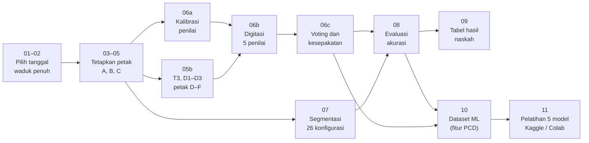

# Segmentasi Permukaan Waduk Saguling di Bawah Objek Apung

Tugas besar mata kuliah Pengolahan Citra Digital (PCD), D4 Teknik Informatika, Politeknik Negeri Bandung.

Penelitian ini menguji seberapa andal metode segmentasi air yang sudah terbit (transformasi satu kanal NDWI, MNDWI, NDVI, grayscale RGB, dan PCA1 dengan ambang tetap, Otsu, dan Canny–Otsu, ditambah morfologi) ketika permukaan waduk tertutup eceng gondok dan keramba jaring apung (KJA). Fitur hasil pengolahan citra itu lalu dipakai machine learning untuk memisahkan air, eceng gondok, dan KJA. Data: citra Sentinel-2 di Google Earth Engine (GEE).

**Tim:** Muhammad Nabil Syauqi Rasyiq – 241524018, Praditama Ajmal Hasan – 241524023

## Latar belakang singkat

PLN Indonesia Power dan Pemkab Bandung Barat mengendalikan eceng gondok di Saguling setiap tahun; pada pertengahan 2026 sekitar 120 ha permukaan tertutup dan berpotensi mengganggu pasokan PLTA hingga 700 MW. Dispernakan Bandung Barat mencatat 45.464 petak KJA sampai 2025, melebihi kapasitas. Kedua masalah itu butuh data luas dan lokasi yang diperbarui rutin. Sentinel-2 gratis dan rutin, tetapi metode indeks air hanya membaca air yang terlihat, sehingga permukaan di bawah objek apung hilang dari peta. Sumber berita ada di [docs/referensi.md](docs/referensi.md).

## Rumusan masalah

1. Seberapa akurat 26 konfigurasi segmentasi pada air terbuka (titik A) dibandingkan akurasi yang dilaporkan jurnal?
2. Seberapa besar akurasi dan luas waduk turun pada permukaan yang tertutup eceng gondok (titik B) dan keramba (titik C)?
3. Apakah closing dan hole filling memulihkan hasil, dan apakah konfigurasi terbaik tetap sama di ketiga titik?

## Rancangan

| Komponen | Isi | Rujukan utama |
| --- | --- | --- |
| Transformasi satu kanal | NDWI, MNDWI, NDVI, grayscale (RGB), PCA1 | Du dkk. (2016); Gonzalez & Woods (2018) |
| Ambang | Tetap 0, Otsu global, Canny–Otsu | Du dkk. (2016); Donchyts dkk. (2016); Markert dkk. (2024) |
| Pascaproses | Tanpa, atau closing + hole filling | Soille (2003); Gonzalez & Woods (2018) |
| Titik uji | A air terbuka, B eceng gondok, C KJA; petak 1 × 1 km | Chuzaimah dkk. (2025); Ji dkk. (2009) |
| Tanggal | T1 dan T2 saat waduk penuh dengan muka air setara | Keputusan tim dari keterbatasan Chuzaimah dkk. (2025) |
| Referensi | Lima penilai, voting minimal 3 dari 5 | Stehman & Foody (2019); Olofsson dkk. (2014) |
| Evaluasi | IoU, F1, bias luas, Spearman ρ, per tingkat kesepakatan | Olofsson dkk. (2014) |

26 konfigurasi = (3 indeks ternormalisasi × 3 ambang + 2 transformasi lain × 2 ambang) × 2 pascaproses; ambang tetap 0 hanya untuk indeks ternormalisasi. Konfigurasi terbaik dipilih dari petak dan tanggal latih, bukan dari tanggal uji T3. Alasan tiap keputusan ada di [docs/laporan/](docs/laporan/) dan [docs/panduan-penilai.md](docs/panduan-penilai.md).

## Alur langkah



Anggota tim menggambar referensi (06b) sebelum Langkah 07 dijalankan, agar referensi tidak terpengaruh hasil segmentasi.

Langkah 05b, 10, dan 11 untuk pengujian machine learning: model dilatih pada petak A–C (T1, T2) dan petak tambahan D, E, F (masing-masing pada D1, D2, D3), lalu diuji pada petak A–C tanggal T3. Rancangan eksperimennya dikunci di [docs/metodologi-ml.md](docs/metodologi-ml.md).

## Struktur repository

```
gee/        skrip Earth Engine 01–10; 00_BACA_DULU.txt berisi urutan, versi Asset, dan panduan galat
python/     09_membuat_tabel_hasil.py (hanya pustaka standar Python 3.8+)
ml/         11_pelatihan_model.ipynb (Kaggle/Colab) dan buat_notebook.py (sumber notebook)
tools/      buat_06b_v2.py (membuat lima file digitasi 06b v2 dari satu templat)
docs/       panduan penilai, referensi, laporan progres, materi kalibrasi, Excel pemetaan skrip
data/       CSV kecil hasil ekspor GEE
hasil/      tabel_hasil.md dan gambar untuk naskah
presentasi/ PDF deck tiap presentasi progres
```

## Cara menjalankan

1. Baca `gee/00_BACA_DULU.txt`.
2. Di [code.earthengine.google.com](https://code.earthengine.google.com), buat skrip dengan nama yang sama seperti di `gee/`, tempel isinya, lalu jalankan berurutan. Setiap skrip punya bagian `0. PARAMETER` di atas.
3. Untuk Langkah 06, ikuti [docs/panduan-penilai.md](docs/panduan-penilai.md). Satu penilai memakai satu file `06a_kalibrasi_pN.js` dan satu file `06b_digitasi_pN.js`.
4. Unduh CSV dari Google Drive (folder `PCD_Saguling`) ke `data/`, lalu:

```bash
python python/09_membuat_tabel_hasil.py data/08_evaluasi_vote_v2_v2.csv data/07_ambang_otomatis_v2.csv \
    data/06c_kesepakatan_vote_v2.csv data/06c_iou_pasangan_vote_v2.csv
```

Hasilnya `tabel_hasil.md` dan `09_pemilihan_konfigurasi.csv` (Tabel XIV: konfigurasi terbaik untuk Langkah 10); pindahkan ke `hasil/`.

5. Machine learning: jalankan `gee/10_membuat_dataset_ml.js` (mode `periksa`, lalu `ekspor`, lalu `ekspor_waduk`), kemudian buka `ml/11_pelatihan_model.ipynb`:
   - **Kaggle**: *New Notebook* → *File* → *Import Notebook*, unggah CSV `dataset_*` dan `waduk_*` sebagai Dataset (*Add Input*), lalu *Run All*.
   - **Colab**: *File* → *Upload notebook*, lalu *Run all*; notebook membaca CSV dari Drive folder `PCD_Saguling`.
   Hasil tersimpan di `hasil_ml/`. Notebook diubah lewat `ml/buat_notebook.py`, lalu `python ml/buat_notebook.py`.

Skrip GEE di repository ini adalah sumber utama. Ubah di sini dulu, commit, lalu tempel ke GEE, supaya versi di GEE dan di laporan tidak berbeda.

## Privasi

Penilai ditulis dengan kode p1–p5 saja. Nama penilai dan lembar catatan bernama disimpan di luar repository.